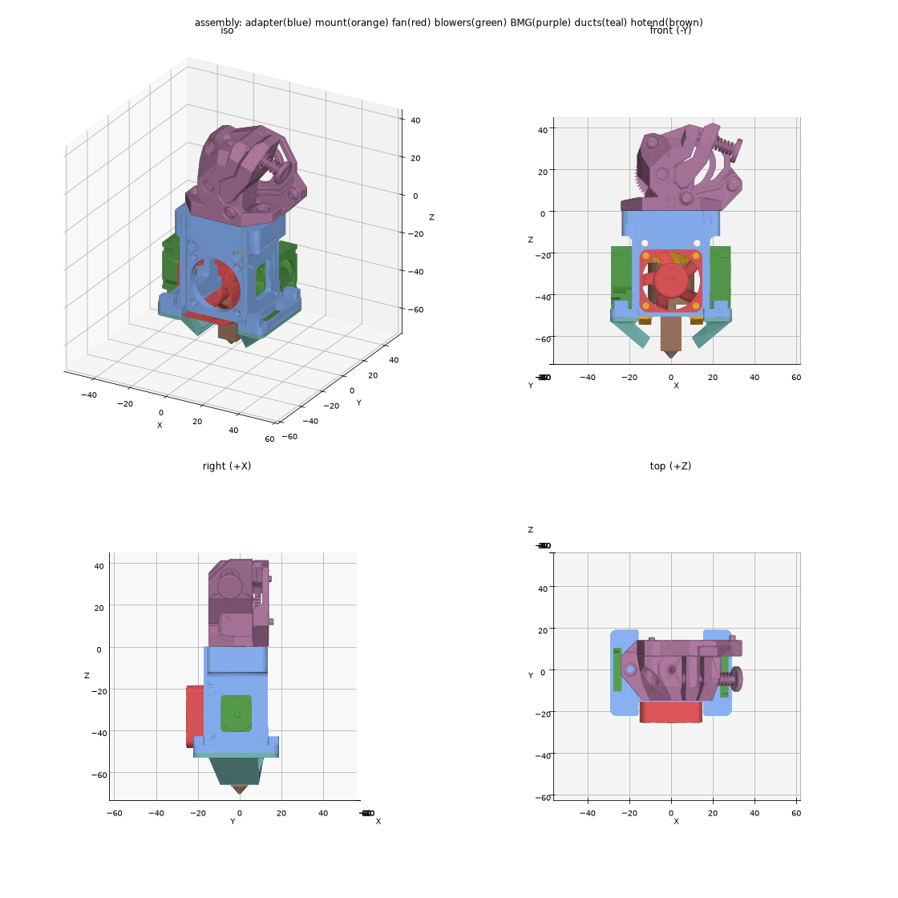

# Assembly

Directions used below: **front** is the 3010 fan side, **back** is the BMG motor side, **left/right** are the blower sides.

## Bill of materials

### Printed parts

| Qty | Part | File | Material | Orientation |
|---|---|---|---|---|
| 1 | Adapter | `output/inserts/toolhead_adapter.stl` | ABS/ASA | Upside down, top plate on the bed. Supports are built in: turn slicer supports off |
| 1 + 1 | Right duct and left duct (they differ, and each has its letter on the flange) | `output/inserts/duct_R.stl`, `output/inserts/duct_L.stl` | ABS/ASA, or something more heat-resistant | Flange down, flat top face of the flange on the bed |
| 1 | Voron 0.2 X carriage | `X_Carriage_x1`, the one a Mini Stealthburner hangs on. Keep the one on your printer | ABS/ASA | As its source says |
| 1 | Toolboard mount (optional, for an EBB36) | `output/inserts/toolboard_mount.stl` | ABS/ASA | Front face (the flat side without bosses) on the bed. No supports |

The STL files are already turned to these orientations and sit on the bed. Import them as they are.

### Purchased parts

| Qty | Part | Notes |
|---|---|---|
| 1 | Wristwatch BMG extruder | Complete, with its motor and hardware, built to its own instructions |
| 1 | TZ-V6 2.0 hotend | The kit's top part is not used |
| 1 | TZ-V6 2.0 hotend mount module | The one the Mini Stealthburner uses (`hotend_mount.STEP`) |
| 1 | Silicone sock for the heater block | Required: the ducts sit about 5 mm from the block |
| 1 | 3010 axial fan (30×30×10) | Heatsink fan |
| 2 | 3010 radial blower (30×30×10) | Part cooling |
| 1 | PTFE tube, 4 mm OD | Runs from the BMG down into the heatsink. Cut to length during assembly |

### Hardware

| Qty | Part | Where it goes |
|---|---|---|
| 6 | M3 heat-set insert, Ø5 × 4 mm long (for a Ø4.0 hole) | 2 top plate, 4 front plate |
| 2 | M3 hex nut (5.5 mm across flats, 2.4 mm thick) | X carriage, for the hotend-mount screws (if not already in it) |
| 2 | M3×8 socket head screw | BMG to the top plate. The inserts sit at the top face, so the thick plate needs no longer screw |
| 2 | M3×30 socket head screw | Toolhead and hotend mount module to the X carriage, into the nuts in its slots. The tip ends about 0.3 mm past the nut, 2.3 mm short of the end of the hole |
| 2 | M3×35 and M3×30 socket head screw, 1 each (toolboard) | Replace the 2 motor screws, so their tips stick out of the motor's back for the standoffs |
| 2 | M3×10 female-female standoff, 5 mm across flats (toolboard) | On the motor screw tips, behind the motor |
| 2 | M3×8 socket head screw (toolboard) | Toolboard mount to the standoffs |
| 2 | M3 heat-set insert, Ø5 × 4 mm (toolboard) | Toolboard mount's bosses |
| 2 | M3×6 socket head screw (toolboard) | EBB36 to the mount, into the inserts |
| 4 | M3×12 screw | 3010 fan to the front plate. Don't go longer than 14 mm, or the screws hit the hotend mount |
| 4 | M2.5 self-tapping screw | Blowers to the arms, 2 each. Length = blower ear thickness + up to 3 mm (M2.5×12 for full-height 10 mm ears). Any longer and the tip hits the hotend mount |
| 4 | M2.5×8 self-tapping screw | Ducts to the shelves, 2 each |
| 4 | M2.5×6 hotend screws | Heatsink to the mount module. Use the ones from the hotend kit, as on the Mini Stealthburner |

If your inserts aren't Ø5 × 4 mm, change `INSERT_D` / `INSERT_L` in `cad/toolhead_adapter.py` and rebuild before printing.

### Tools

Soldering iron with a heat-set insert tip, 2.5 mm and 1.5 mm hex keys, Phillips screwdriver for the self-tapping screws, PTFE tube cutter or a sharp blade.

## Steps

### 1. Prepare the printed parts

1. Remove the built-in supports: the combs under each shelf and duct lug, and the ribs in the fan opening. Break them off at their tabs with pliers. Then clean the tab marks off the faces they stood on.
2. Test-fit the hotend mount module in the frame, behind the front plate, between the arms and up against the underside of the top plate. It should slide in by hand without force (0.1 mm clearance to the front plate, 0.2 mm to each arm). Sand or scrape the inner faces if it binds.
3. Clear the blower and duct pilot holes with a 2.2 mm drill if they came out undersized.

### 2. Install the heat-set inserts (6×)

Press each insert in square to the face until it sits flush. Let it cool before moving on.

1. **Top plate, 2×:** from the top face, in the two blind holes either side of the filament hole.
2. **Front plate, 4×:** from the front face, at the corners of the Ø28 fan opening.

### 3. Attach the hotend to the mount module

1. Leave out the kit's top part. The heatsink's top face seats directly on the underside of the mount's plate.
2. Fix the heatsink with its 4 screws.
3. Rotate the hotend so the heater's 10 mm side (the one with the ears) runs left–right, toward the blowers. The ducts are sized for this. Turning it 90° also works and adds 0.9 mm of duct clearance.
4. Fit the silicone sock.
5. Route the heater and thermistor wires out to the side. The X carriage covers the back of the mount module.

### 4. Fit the mount module into the frame

1. With the ducts still off, slide the mount module up into the frame from below, behind the front plate, plate side up, until it stops against the underside of the top plate.
2. Push 2× M3×30 screws in from the front, through the counterbored holes and the mount's horizontal holes. They hold the mount module in the frame until the toolhead goes on the X carriage (see [X carriage](#x-carriage-voron-02)), where they end in its nuts. Their tips stick out about 5.7 mm behind the mount's back face.

### 5. Fit the PTFE tube

1. Push the PTFE tube down through the filament hole in the top plate until it bottoms out in the heatsink.
2. Cut it about 6 mm above the top plate's top face, so it reaches up into the BMG's 6.2 mm deep tube seat when the BMG sits flat on the plate. That puts its end about 31 mm above the heatsink's top face, plus however far it goes down into your heatsink. Don't reuse a tube cut for a thinner plate: this one is 6 mm longer than on a 6 mm plate.
3. Cut the end square and chamfer the inside edge lightly.

### 6. Mount the heatsink fan

1. Put the 3010 fan on the front plate over the Ø28 opening so that it **blows into the heatsink**. On most fans, that means the label and strut side faces the heatsink.
2. Fix it with 4× M3×12 into the front plate inserts.

### 7. Mount the blowers (both sides)

1. Hold the blower against the outer face of the arm with its outlet pointing **down** into the opening in the shelf and its inlet facing outward.
2. Its two diagonal ears line up with the two pilot holes in the arm.
3. Drive 2× M2.5 self-tapping screws through the ears into the arm. Stop when the blower is snug, because the threads are cut in plastic.
4. Repeat on the other side.
5. The right blower's wire leaves its back edge right next to the lower belt, with only about 0.55 mm between the blower and the belt. Bend it **down** straight away, along the back of the blower to the shelf, so it can't rub on the belt. The left blower's wire leaves at the front and has room.

### 8. Fit the ducts (both sides)

1. The two ducts differ. **R** goes on the right (the +X side, on your right when you face the fan) and **L** on the left. The letter is on the flange's underside, and a duct's screw holes only line up on its own side.
2. Hold a duct with its flange against the underside of the shelf so the outlet points in toward the nozzle.
3. Fix it with 2× M2.5×8 self-tapping screws up into the shelf.
4. Repeat on the other side with the other duct.
4. Check that neither duct touches the heater block or the sock. There should be about 5 mm of air gap to the bare block, and the lowest point of each duct should sit about 4.5 mm above the nozzle tip.

### 9. Mount the BMG

1. Set the BMG on the top plate with its motor toward the back. On the printer, the motor sits over the X carriage.
2. Make sure the PTFE tube enters its tube seat.
3. Fix it with 2× M3×8 screws down through the BMG flange into the top plate inserts.

### 10. Wire up and check

1. Connect the hotend fan, the blowers, the heater and the thermistor. Use the same pins and fan config as on your Mini Stealthburner, and check that the fan voltage matches your board.
2. Tie the wires so none can reach the heater block, sit in front of the blower inlets or touch the belts.
3. Heat to printing temperature and check the following:
   - The heatsink fan blows into the heatsink.
   - Both blowers blow out of the duct tips.
   - Nothing touches the block or the sock.
   - Filament feeds through smoothly.
4. Re-tighten the nozzle hot as usual for the TZ-V6.

## X carriage (Voron 0.2)

The toolhead hangs on the Voron 0.2 X carriage the way the Mini Stealthburner does. The X carriage stays on the MGN7H carriage with the belts clamped in it, so nothing on the printer changes. The two hotend-mount screws end in M3 nuts in slots in it.

1. Drop an M3 nut into each of the two slots in the X carriage's top, just behind its front face, if they aren't in already. They fall to the bottom of the slot, in line with the two holes in its front face.
2. Hold the toolhead against the X carriage's front face, with the tips of the two M3×30 screws in its holes. The BMG goes over the top of the X carriage, and the top plate's notch fits around it.
3. Tighten the screws evenly from the front (the hex key reaches their heads above the fan) until the mount module's back face sits flat on the X carriage. Stop once they're snug.

To take the toolhead off, undo the same 2 screws. The BMG and the belts can stay where they are.

The BMG's bottom face clears the boss on the X carriage's top by 0.7 mm, and the motor clears the X carriage by about 6 mm. The belts pass 0.55 mm behind the adapter's sides and the blowers.

The nozzle sits 10.85 mm in front of the X carriage's front face (27.35 mm in front of the rail's centre line) and 55 mm below the hotend-mount screws. The Y position and the mount's seat are the Mini Stealthburner's: `MiniSB_Bowden.step` has the same X carriage face, screw holes and mount seat, and the filament on the X carriage's centre. That file has no hotend in it, so the height assumes this mount module and the 45.6 mm TZ-V6 2.0 from the drawing. If your Mini Stealthburner used the same mount and hotend, your X and Y `position_endstop` and `position_max` need no change for the nozzle position. Re-do your Z offset as after any hotend work.

The nozzle staying put doesn't mean the rest of the toolhead takes the same room, so move it slowly to the ends of its travel the first time. The BMG's top is about 54 mm above the mount top (the Mini Stealthburner's cowling: about 16 mm), the front reaches 25.4 mm in front of the nozzle (cowling: 22.7 mm), and with the EBB36 fitted the board's back is 19.8 mm behind the X carriage.

The Ø22 heatsink reaches 0.15 mm past the mount module's back face, so in the model it touches the X carriage's front face in a strip about 3.5 mm wide. The same goes for a Mini Stealthburner with this mount and hotend, and nothing in the adapter can change it without moving the nozzle. If the mount module won't sit flat on the X carriage, scrape a shallow flat into that strip of the X carriage's face.

## EBB36 toolboard (optional)

The mount holds a BTT EBB36 CAN on the back of the BMG motor, on two M3 female-female standoffs threaded onto the motor screws. The motor screws sit on a diagonal, so the mount turns the board level and centres it on the motor. That keeps its bottom edge about 4 mm above the adapter's top face and clear of the X carriage under the motor.

1. Take out the BMG's 2 motor screws, one at a time so the motor stays put. Put in longer ones the same way, heads in the BMG: M3×35 in the upper hole, M3×30 in the lower one. Their tips should stick out about 4.3 mm past the motor's back face. If yours stick out more than 5 mm, use a shorter screw, or the mount screw won't have room in the standoff.
2. Thread an M3×10 female-female standoff onto each tip until it seats on the motor.
3. Press an M3 heat-set insert into the top of each of the mount's two bosses.
4. Fix the mount to the standoffs with 2× M3×8 through the counterbored holes, heads on the board side.
5. Screw the EBB36 to the two bosses. It goes either way round, so turn its connectors where your wiring needs them.

## Replacing a duct

Remove its 2 screws, fit the new duct, and screw it back in. Nothing else has to come off.
