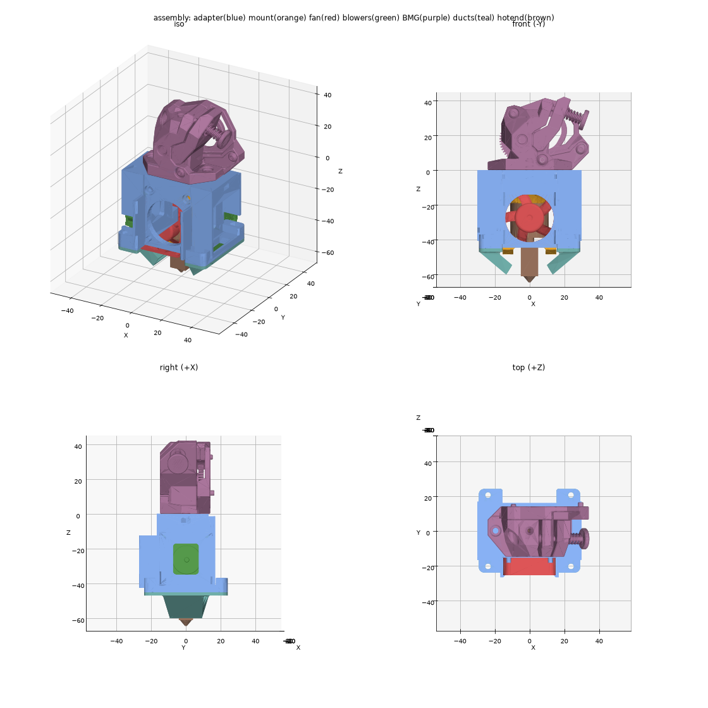

# Assembly: captive-nut version

This version has no heat-set inserts and no self-tapping screws. Every screw is an M3 going into a nut held in a pocket or slot. The 3010 fan and both blowers snap into cradles and need no screws.

Directions used below: **front** is the 3010 fan side, **back** is the BMG motor side, **left/right** are the blower sides.

## Bill of materials

### Printed parts

| Qty | Part | File | Material | Orientation |
|---|---|---|---|---|
| 1 | Fit test (print this first) | `output/nuts/fit_test.stl` | Same as the adapter | Blower piece: top face on the bed. Fan piece: plate face on the bed |
| 1 | Adapter | `output/nuts/toolhead_adapter.stl` | ABS/ASA | Upside down, top plate on the bed |
| 2 | Duct (both sides use the same part) | `output/nuts/2x_duct.stl` | ABS/ASA, or something more heat-resistant | Flange down, flat top face of the flange on the bed |

The STL files are already turned to these orientations and sit on the bed. Import them as they are.

### Purchased parts

| Qty | Part | Notes |
|---|---|---|
| 1 | Wristwatch BMG extruder | Complete, with its motor and hardware, built to its own instructions |
| 1 | TZ-V6 2.0 hotend | The kit's top part is not used |
| 1 | TZ-V6 2.0 hotend mount module | Printed, from [Printables 704371](https://www.printables.com/model/704371-voron-v02-mount-for-tz-v2-tz-v6-20) or the Siboor V0.2 kit (`hotend_mount.STEP`) |
| 1 | Silicone sock for the heater | Required: the ducts sit about 5 mm from the heater |
| 1 | 3010 axial fan (30×30×10) | Heatsink fan |
| 2 | 3010 radial blower (30×30×10) | Part cooling |
| 1 | PTFE tube, 4 mm OD | Runs from the BMG down into the heatsink. Cut to length during assembly |

### Hardware

| Qty | Part | Where it goes |
|---|---|---|
| 8 | M3 hex nut (5.5 mm across flats, 2.4 mm thick) | 2 top plate (BMG), 2 back tab, 4 duct lugs |
| 2 | M3×10 socket head screw | BMG to the top plate |
| 2 | M3×30 socket head screw | Hotend mount module to the frame. The tip ends about 0.6 mm past the back face |
| 4 | M3×10 socket head screw | Ducts to the shelves, 2 each |
| 4 | M2.5×6 hotend screws | Heatsink to the mount module. Use the ones from the hotend kit, as on the Mini Stealthburner |

The fan and blowers need no screws.

### Tools

2.5 mm hex key, a small flat screwdriver or a pick for pushing nuts into their slots, PTFE tube cutter or a sharp blade.

## Steps

### 1. Print and check the fit test

The fan, blower and hotend dimensions come from unofficial models and an unofficial drawing, so check the snap fits before printing the whole adapter.

1. **Fan piece:** push the fan in, label side first, lower holes over the two pegs. Both side lips should click over its corners. The fan should sit without rattling and come out when you flex one side wall outward.
2. **Blower piece:** push the blower in against the arm, outlet down into the shelf opening, inlet facing out. The lips at the bottom of its front and back walls should click over its outer face.
3. **Nuts:** a nut should go into each pocket on the lugs, and into the side slot just under the top face.

If a fit is too tight or too loose, change `CRADLE_FIT` (0.15 mm per side) or `NUT_AF` (5.7 mm) in `cad/toolhead_adapter.py`. Then rebuild with `python cad/toolhead_adapter.py --nuts` and print the fit test again.

### 2. Prepare the adapter

1. Remove any supports, mostly from under the shelves and arms.
2. Test-fit the hotend mount module in the gap between the front plate and the back tab. It should slide in by hand without force (0.1 mm clearance per side). Sand or scrape the inner faces if it binds.

### 3. Fit the nuts in the frame (4×)

1. **Top plate, 2×:** each BMG hole has a slot that opens on the left or right side face, just under the top face. Slide a nut in flat and push it to the end of the slot. It stops centred under the hole. Check with a screw from above.
2. **Back tab, 2×:** press a nut into each hex pocket in the back face, in line with the counterbored holes in the front plate.

### 4. Attach the hotend to the mount module

1. Leave out the kit's top part. The heatsink's top face seats directly on the underside of the mount's plate.
2. Fix the heatsink with its 4 screws.
3. Rotate the hotend so the heater's 10 mm side (the one with the ears) runs left–right, toward the blowers. The ducts are sized for this. Turning it 90° also works and adds 0.9 mm of duct clearance.
4. Fit the silicone sock.
5. Route the heater and thermistor wires up along the back of the mount.

### 5. Fit the mount module into the frame

1. Slide the mount module up into the frame from below, between the front plate and the back tab, plate side up, until it stops against the underside of the top plate.
2. Push 2× M3×30 screws in from the front, through the counterbored holes and the mount's horizontal holes, into the back tab nuts.
3. Tighten them evenly. Stop once they're snug, or the screws will bow the back tab.

### 6. Fit the PTFE tube

1. Push the PTFE tube down through the filament hole in the top plate until it bottoms out in the heatsink.
2. Cut it so it reaches up into the BMG's tube seat when the BMG sits flat on the top plate. Use the Wristwatch BMG's own guide for how far the tube should reach.
3. Cut the end square and chamfer the inside edge lightly.

### 7. Snap in the heatsink fan

1. Hold the fan with its label and strut side toward the front plate, so it **blows into the heatsink**. Turn it so the corner where the wire leaves is at the top. The cradle has no top wall, so the wire comes straight out.
2. Put its two lower holes over the pegs and push it straight in until both side lips click over its front corners.
3. To remove it, flex one side wall outward and pull the fan off the pegs.

### 8. Snap in the blowers (both sides)

1. Hold the blower with its outlet pointing **down** into the opening in the shelf, inlet facing out.
2. The wire leaves one side near the outlet. On the right blower it goes to the back, on the left blower to the front, into the notch in the cradle wall.
3. Push the blower straight in against the arm until the lips at the bottom of the front and back walls click over its outer face. The block above it stops it from tipping out.
4. To remove it, spread the bottom ends of the front and back walls slightly and pull it out.

### 9. Fit the ducts (both sides)

1. Drop an M3 nut into the hex pocket on top of each lug, in front of and behind each blower (4 total).
2. Hold a duct with its flange against the underside of the shelf so the outlet points in toward the nozzle.
3. Fix it with 2× M3×10 screws up through the flange and shelf into the nuts.
4. Repeat on the other side with the second duct. It's the same part, turned 180°.
5. Check that neither duct touches the heater or the sock. There should be about 5 mm of air gap to the bare heater, and the lowest point of each duct should sit about 4.5 mm above the nozzle tip.

### 10. Mount the BMG

1. Set the BMG on the top plate with its motor toward the back, over the stepped-down relief at the back edge.
2. Make sure the PTFE tube enters its tube seat.
3. Fix it with 2× M3×10 screws down through the BMG flange into the top plate nuts.

### 11. Wire up and check

1. Connect the hotend fan, the blowers, the heater and the thermistor. Use the same pins and fan config as on your Mini Stealthburner, and check that the fan voltage matches your board.
2. Tie the wires so none can reach the heater or sit in front of the blower inlets.
3. Heat to printing temperature and check the following:
   - The heatsink fan blows into the heatsink.
   - Both blowers blow out of the duct tips.
   - Nothing touches the heater or the sock.
   - Filament feeds through smoothly.
4. Re-tighten the nozzle hot as usual for the TZ-V6.

## MGN7H carriage mount (Voron 0.2)

`output/nuts/carriage_mount.stl`: print 1 in ABS/ASA, upside down (flat top face on the bed).

The mount is an L-bracket. Its plate sits on top of the MGN7H carriage, under the BMG motor, and its flange sits against the adapter's back face. It shares the two hotend-mount screws, which changes steps 3 and 5:

- **Step 3:** skip the 2 back tab nuts. Use 2 M3 nuts in the flange instead.
- **Step 5:** use 2× M3×35 instead of M3×30. They go through the front plate, the mount module and the back tab, then into the flange nuts.

To fit it:

1. Bolt the mount to the carriage with 4× M2×5 socket head screws. Use 5 mm, no longer, or the screws hit the rail.
2. Drop an M3 nut into each of the two slots in the top face of the flange. They fall to the bottom of the slot, in line with the screw holes. Once the toolhead is on, the BMG motor sits over the slots.
3. Hold the toolhead against the flange and drive the 2× M3×35 in from the front.

To take the toolhead off, remove those 2 screws. The mount stays on the carriage, and the nuts stay in their slots.

The flange covers the back of the mount module, so route the hotend wires out to the side.

## Replacing a duct

Remove its 2 screws, fit the new duct, and screw it back in. The nuts stay in their pockets, and nothing else has to come off.
