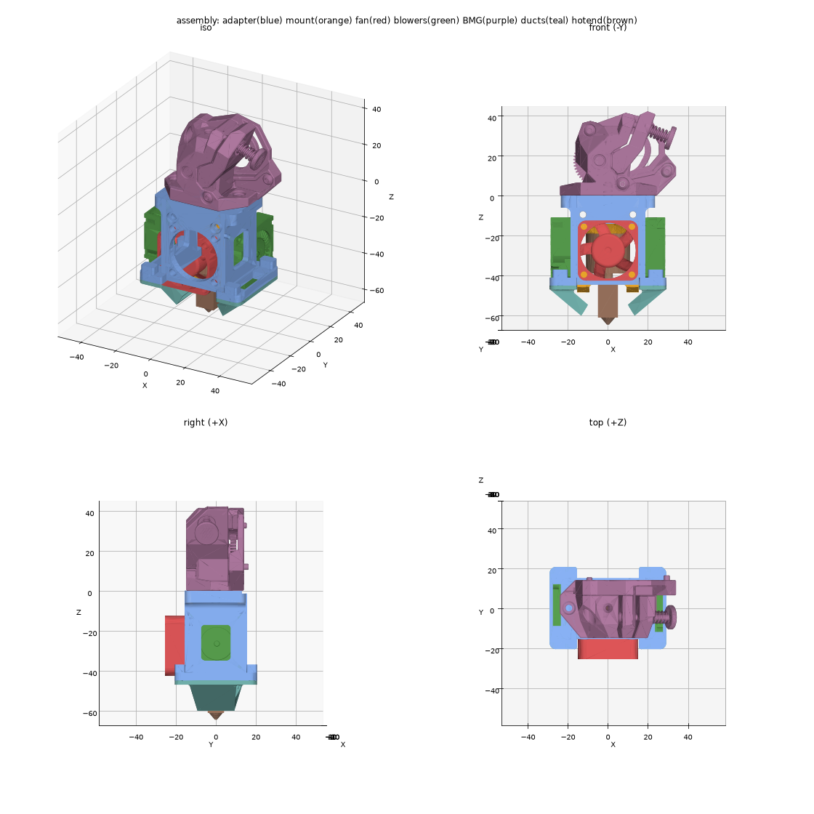

# Minimal ABS Toolhead v02

A printed adapter that hangs a TZ-V6 2.0 hotend under a **Wristwatch BMG** extruder, with a 3010 heatsink fan and two 3010 part-cooling blowers. No casing or shrouding, only structure plus two short, replaceable ducts.



The bill of materials and step-by-step build are in [ASSEMBLY.md](ASSEMBLY.md).

There are two versions of the printed parts:

- **Heat-set inserts** (`output/inserts/`): described below.
- **Captive nuts** (`output/nuts/`): no heat-set inserts and no self-tapping screws. All screws are M3 into nuts held in pockets and slots, and the 3010 fan and both blowers snap into cradles with no screws at all. Build and BOM: [ASSEMBLY_NUTS.md](ASSEMBLY_NUTS.md).

## What's in the part

- **Top plate:** the BMG bolts on with 2× M3×8 screws, going down through its flange into M3 heat-set inserts, 37 mm apart: 17.5 mm from the filament on one side and 19.5 mm on the other, matching the BMG. The PTFE tube passes straight through on the filament axis.
- **Hotend mount module:** slides up between a front plate and a back tab. It's held by 2× M3×35 screws through its horizontal holes and the back tab, into M3 nuts in the carriage mount behind it. The hotend is used like on the Mini Stealthburner: without the kit's top part, with the heatsink screwed straight to the mount.
- **Frame:** the front plate and back tab run out to the blower arms, so the frame is a closed box.
- **Carriage mount:** part of the adapter, behind the back tab. Its plate bolts on top of the Voron 0.2's MGN7H X carriage with 4× M2×5 screws, under the BMG motor, so the BMG comes off to take the toolhead off the carriage.
- **3010 fan:** mounts on the front plate over the Ø28 opening with 4× M3 inserts. Fit it so it blows into the heatsink.
- **2× 3010 blowers:** one on each side, held by M2.5 self-tapping screws through their diagonal ears. Each one sits on a shelf with an opening under its outlet.
- **Toolboard mount (separate part, optional):** holds a BTT EBB36 CAN on the back of the BMG motor, on two M3 female-female standoffs on the motor screws, as usual on the Voron 0.2. The motor screws sit on a diagonal, so the mount turns the board level and centres it on the motor, which keeps its bottom edge clear of the carriage mount.
- **2× ducts (separate parts):** each screws up into the underside of a shelf with 2× M2.5×8 self-tapping screws. Both ducts are the same part. They're the parts that run hottest, so they're made to be swapped, and you can print them in a more heat-resistant material than the frame.

Print the adapter upside down (top plate on the bed). The whole top face, carriage mount included, is flat at the same height. Print the ducts (2 copies of `2x_duct.stl`) flange-down (the flange's flat top face on the bed). Use ABS/ASA for both. The STL files are already turned to these orientations. The STEP files stay in the assembly frame.

The adapter STL has its supports built in, so print it with slicer supports off. They're thin walls under the shelves, the duct lugs, the fan opening and (captive-nut version) the snap-fit cradle walls. Each one stops one 0.2 mm layer short of the face it holds up. Where one stands on the part instead of the bed, only short tabs touch it, so it snaps off cleanly. None of them go into a nut pocket or slot. The `SUP_*` constants in `cad/toolhead_adapter.py` set the wall thickness, spacing and gaps. The STEP has no supports, so you can use your slicer's own supports instead if you prefer. `render_print.png` shows the adapter as printed, with its supports.

## Files

| Path | Contents |
|---|---|
| `ASSEMBLY.md` | Bill of materials and assembly steps |
| `ASSEMBLY_NUTS.md` | The same, for the captive-nut version |
| `output/inserts/`, `output/nuts/` | One folder per version, each with the printed parts: `toolhead_adapter.stl` (carriage mount included), `2x_duct.stl` (print 2) and `toolboard_mount.stl`. STEP files alongside |
| `output/nuts/fit_test.stl` | Two small pieces for checking the fan and blower snap fits before printing the adapter |
| `output/*/render_*.png` | Renders of the adapter, the adapter as printed with its built-in supports, the duct, the full assembly, and the assembly on the carriage |
| `cad/toolboard_mount.py` | Parametric EBB36 toolboard mount. Run it to export it and check the fit behind the motor |
| `cad/carriage_mount.py` | Parametric carriage mount, fused onto the adapter by `toolhead_adapter.py`. Run it to check the fit on the carriage |
| `cad/toolhead_adapter.py` | Parametric build123d model; every dimension is a named constant at the top |
| `third_party/` | Third-party models and reference material, not in git (see Rebuilding) |
| `cad/show.py` | Shows the full assembly in the OCP CAD Viewer (VS Code) |
| `cad/render.py`, `cad/inspect_step.py`, `cad/list_step_*.py` | Helpers to render and inspect STEP files |

## Rebuilding

The model places third-party parts to check fit, and those parts aren't redistributed here. They live in `third_party/`, which git ignores. On a new clone, copy that folder over from another machine. It holds:

- `Wristwatch BMG v3.step`: the Wristwatch BMG assembly
- `hotend_mount.STEP`: the TZ-V6 2.0 mount module ([Printables 704371](https://www.printables.com/model/704371-voron-v02-mount-for-tz-v2-tz-v6-20)). Its outside matches the official Voron 0.2 Mini Stealthburner hotend mounts
- `3010 fan.step`: a 30×30×10 axial fan
- `3010 blower.STEP`: a 30×30×10 radial blower

Reference only, not loaded by the scripts:

- `hotend mounts voron 0/`: the official Voron 0.2 hotend mounts, used to check `hotend_mount.STEP`
- `tzv6 unofficial.jpg`: the TZ-V6 2.0 dimension drawing
- `photos/`: photos of the actual fan and blower

There's no model of the TZ-V6 2.0 hotend. The script builds a simple stand-in (heatsink, heat break, heater, nozzle) from the dimensions on Trianglelab's drawing. These are the `HE_*` constants: 45.6 mm from the heatsink top face to the nozzle tip, and a 10 × 8.2 × 17 mm heater.

Then:

```
pip install -r cad/requirements.txt
python cad/toolhead_adapter.py            # heat-set insert version
python cad/toolhead_adapter.py --nuts     # captive-nut version
python cad/carriage_mount.py [--nuts]
python cad/toolboard_mount.py [--nuts]
```

This rebuilds `output/inserts/` or `output/nuts/`, including `toolhead_assembly.step`. It prints interference checks between every pair of parts, the gap between each duct and the heater block, and where each screw's tip ends up.

To look at the model in VS Code, install the OCP CAD Viewer extension, open its viewer (OCP icon in the sidebar), then run:

```
python cad/show.py [--nuts]
```

This builds the adapter (with its carriage mount), ducts, the carriage, rail and extrusion, and all third-party parts and sends them to the viewer as separate, coloured objects. Nothing is exported.

## Check before printing

- `HOTEND_ROT`: the mount's screws let the hotend sit at 0° or 90°. The ducts are sized for 0°, which puts the heater's 10 mm side toward them. At 90° the gap grows by 0.9 mm.
- `DUCT_BLOCK_GAP` (5 mm) sets the air gap between the ducts and the bare heater. Use a silicone sock.
- `INSERT_D` must match your heat-set inserts (default Ø4.0).
- The fan, blower and hotend models are unofficial. Captive-nut version: print `output/nuts/fit_test.stl` first and adjust `CRADLE_FIT` if the fit is off.

## License

GPL-3.0. See [LICENSE](LICENSE). This covers the adapter design and the code in this repo, not the third-party models listed above.
