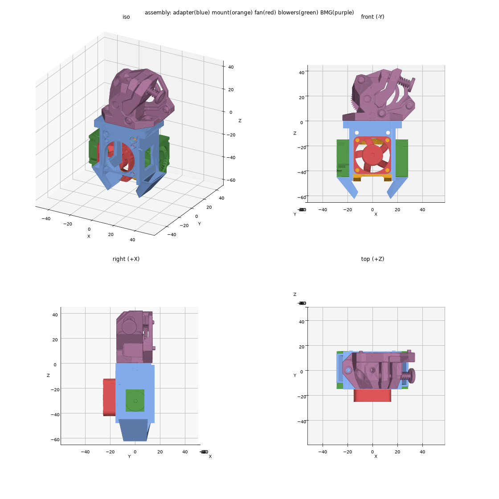

# Minimal ABS Toolhead v02

A printed adapter that hangs a TZ-V6 2.0 hotend under a **Wristwatch BMG** extruder, with a 3010 heatsink fan and two 3010 part-cooling blowers. No casing or shrouding, only structure plus two short, replaceable ducts.



The bill of materials and step-by-step build are in [ASSEMBLY.md](ASSEMBLY.md).

## What's in the part

- **Top plate:** the BMG bolts on with 2× M3×8 screws, going down through its flange into M3 heat-set inserts at ±18.5 mm. The PTFE tube passes straight through on the filament axis.
- **Hotend mount module:** slides up between a front plate and a back tab. It's held by 2× M3×30 screws through its horizontal holes into inserts in the back tab. The hotend is used like on the Mini Stealthburner: without the kit's top part, with the heatsink screwed straight to the mount.
- **Frame:** the front plate and back tab run out to the blower arms, so the frame is a closed box.
- **3010 fan:** mounts on the front plate over the Ø28 opening with 4× M3 inserts. Fit it so it blows into the heatsink.
- **2× 3010 blowers:** one on each side, held by M2.5 self-tapping screws through their diagonal ears. Each one sits on a shelf with an opening under its outlet.
- **2× ducts (separate parts):** each screws up into the underside of a shelf with 2× M2.5×8 self-tapping screws. Both ducts are the same part. They're the parts that run hottest, so they're made to be swapped, and you can print them in a more heat-resistant material than the frame.

Print the adapter upside down (top plate on the bed). Print the ducts flange-down (the flange's flat top face on the bed). Use ABS/ASA for both.

## Files

| Path | Contents |
|---|---|
| `ASSEMBLY.md` | Bill of materials and assembly steps |
| `output/toolhead_adapter.stl` / `.step` | The printable adapter |
| `output/duct.stl` / `.step` | Part-cooling duct, print 2 |
| `output/render_*.png` | Renders of the adapter, the duct and the full assembly |
| `cad/toolhead_adapter.py` | Parametric build123d model; every dimension is a named constant at the top |
| `cad/render.py`, `cad/inspect_step.py`, `cad/list_step_*.py` | Helpers to render and inspect STEP files |

## Rebuilding

The model places third-party parts to check fit, and those parts aren't redistributed here. Before running the script, put these files in the repo root:

- `Wristwatch BMG v3.step`: the Wristwatch BMG assembly
- `hotend_mount.STEP`: the TZ-V6 2.0 mount module
- `assy hotend kit.stp`: the TZ-V6 2.0 hotend (heatsink, top part, nozzle + heater)
- `3010 fan.step`: a 30×30×10 axial fan
- `3010 blower.STEP`: a 30×30×10 radial blower

Then:

```
pip install -r cad/requirements.txt
python cad/toolhead_adapter.py
```

This rebuilds `output/`, including `toolhead_assembly.step`. It prints interference checks between every pair of parts and the gap between each duct and the heater block.

## Check before printing

- `HOTEND_ROT`: the mount's screws let the hotend sit at 0° or 90°. The ducts are sized for 0°, which puts the heater block's 14 mm side toward them. At 90° the gap grows by 1.5 mm.
- `DUCT_BLOCK_GAP` (5 mm) sets the air gap between the ducts and the bare heater block. Use a silicone sock.
- `INSERT_D` must match your heat-set inserts (default Ø4.0).
- In the vendor models, the mount touches the top edge of the heater block (about 4 mm³). Check that the real parts clear.

## License

GPL-3.0. See [LICENSE](LICENSE). This covers the adapter design and the code in this repo, not the third-party models listed above.
